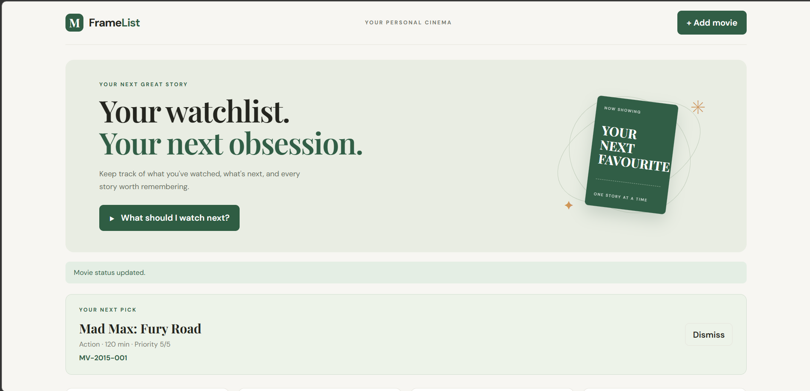
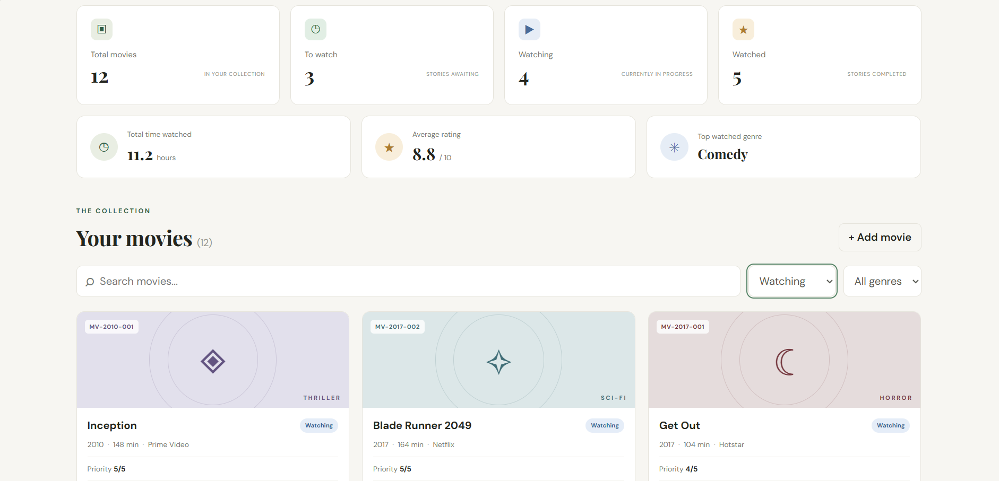
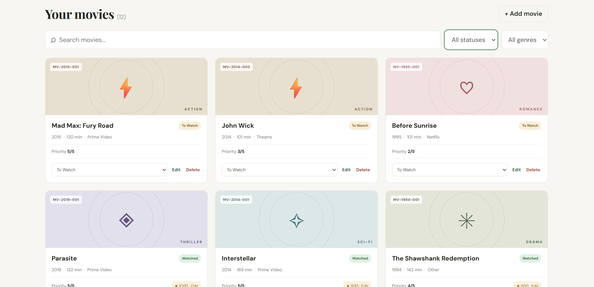

# FrameList — Movie Watchlist Manager

A full-stack MERN application for managing a personal movie watchlist. Users can organize movies, track viewing progress, rate watched movies, and explore watchlist statistics.

## Features

- Add, view, edit, and delete movies
- Search movies and filter by genre and status
- Track movies as To Watch, Watching, or Watched
- Rate watched movies from 1 to 10
- Get a Watch Next recommendation
- View watchlist statistics
- Generate unique movie codes
- Prevent duplicate titles for the same release year
- Restrict deletion of movies currently being watched
- Responsive dashboard for desktop and mobile

## Technology Stack

- **Frontend:** React, Vite, JavaScript, CSS
- **Backend:** Node.js, Express
- **Database:** MongoDB Atlas, Mongoose
- **Tools:** npm, Git, GitHub

## Project Structure

```text
movie-watchlist-manager/
├── backend/
│   ├── models/
│   ├── routes/
│   ├── scripts/
│   ├── server.js
│   ├── package.json
│   └── .env.example
├── frontend/
│   ├── src/
│   └── package.json
├── screenshots/
└── README.md
```

## Prerequisites

- Node.js and npm
- MongoDB Atlas account
- Git

## Installation and Setup

### 1. Clone the repository

```bash
git clone https://github.com/Aleetta007/movie-watchlist-manager.git
cd movie-watchlist-manager
```

### 2. Install backend dependencies

```bash
cd backend
npm install
```

Create `backend/.env` with the following configuration:

```env
PORT=5000
MONGO_URI=your_mongodb_connection_string
```

Replace the placeholder with your own MongoDB Atlas connection string. Never commit real database credentials to a public repository.

### 3. Start the backend

From the `backend` directory:

```bash
npm run dev
```

The API runs at `http://localhost:5000` by default.

### 4. Install and start the frontend

Open a second terminal from the project root:

```bash
cd frontend
npm install
npm run dev
```

Open the local URL printed by Vite.

## Database Seeding

To insert sample movies, run this command from the `backend` directory:

```bash
npm run seed
```

The seed script skips matching movies to avoid duplicate records. Configure `backend/.env` before running it.

## API Documentation

All API responses use a JSON structure containing `success`, `message`, and `data`.

| Method | Endpoint | Purpose |
|---|---|---|
| GET | `/` | API status |
| GET | `/api/health` | Health and database status |
| GET | `/api/movies` | List, search, filter, and paginate movies |
| GET | `/api/movies/stats` | Watchlist statistics |
| GET | `/api/movies/watch-next` | Get a watch recommendation |
| GET | `/api/movies/:id` | Retrieve a movie |
| POST | `/api/movies` | Create a movie |
| PUT | `/api/movies/:id` | Update movie details |
| PATCH | `/api/movies/:id/status` | Change viewing status |
| PATCH | `/api/movies/:id/rating` | Update a watched movie's rating |
| DELETE | `/api/movies/:id` | Delete a movie when permitted |

Refer to `backend/routes/movieRoutes.js` and `backend/models/Movie.js` for exact request fields, query parameters, and validation rules.

## Validation and Business Rules

- Duplicate title and release-year combinations are rejected, ignoring capitalization.
- Movie codes follow the `MV-<year>-<sequence>` format.
- Genres and platforms must match the allowed schema values.
- Runtime and priority must satisfy schema validation.
- Ratings must be between 1 and 10.
- Movies currently marked as Watching cannot be deleted.

## Screenshots

### Dashboard Overview


### Filtered Movie List


### Complete Movie Collection


## Troubleshooting

- **MongoDB connection fails:** Check the connection string, database credentials, and Atlas network access settings.
- **Missing environment variables:** Verify that `backend/.env` exists and defines `PORT` and `MONGO_URI`.
- **Frontend cannot reach the API:** Confirm that the backend is running and check the configured API URL.
- **Dependencies are missing:** Run `npm install` in both the `backend` and `frontend` directories.
- **Port is already in use:** Stop the conflicting process or configure an available port where supported.

## License

Developed as a full-stack application project.
